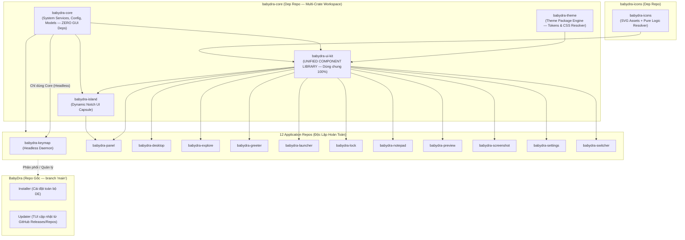
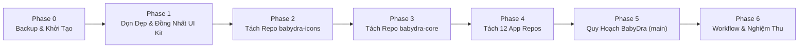

# Kế Hoạch Tái Cấu Trúc Hệ Sinh Thái BabyDra: Monorepo → Multi-Repo & Chuẩn Hóa Unified UI Kit

> **Tầm nhìn & Định hướng:**
> 1. **Giao diện đồng nhất 100% (Unified Design System):** Mọi ứng dụng BabyDra (Settings, Explore, Panel, Desktop, Launcher, Switcher, Notepad...) đều được lắp ghép từ một bộ **Component Library dùng chung duy nhất** (`babydra-ui-kit`). Loại bỏ tình trạng mỗi crate tự viết widget riêng hoặc nhúng mã nghiệp vụ riêng vào UI Kit.
> 2. **Nguyên tắc "Chỉ tách phần dùng chung":** `babydra-ui-kit` chỉ chứa các linh kiện giao diện generic, tái sử dụng được; logic nghiệp vụ đặc thù nằm nguyên vẹn tại repo của ứng dụng tương ứng.
> 3. **Hệ thống 3 trụ cột:**
>    * **`babydra-core`** (Dep repo đa package): Chứa Core Services (Headless), Theme Engine, Unified UI Kit và Island Widget.
>    * **`babydra-icons`** (Dep repo riêng): Chứa tài nguyên SVG icons dark/light, logo và resolver thuần logic.
>    * **12 Application Repos**: Mỗi app là 1 repo riêng, giữ nguyên tên crate hiện tại.
>    * **`BabyDra` (Repo gốc)**: Gộp về **branch `main` duy nhất**, chỉ chứa **Installer** + **Updater** + cấu hình phân phối.
> 4. **Khả năng chạy trên nhiều nền tảng DE:** Cấu trúc Core và UI Kit được trừu tượng hóa, không gắn chết với một compositor hay layer shell duy nhất.

---

## 1. Phân Tích Hiện Trạng & Vấn Đề Cần Giải Quyết

### 1.1. Hiện trạng phân mảnh giao diện (Inconsistent UI & Leaky Abstractions)

Hiện tại, `libs/babydra-ui-kit` đang gặp phải 2 nghịch lý lớn:

1. **Bị "rò rỉ" code đặc thù của crate riêng vào UI Kit:**
   * Thư mục `libs/babydra-ui-kit/src/components/explore/` chứa toàn bộ context menu, dialog nén/giải nén, thuộc tính file, xung đột file của riêng ứng dụng `babydra-explore`.
   * Thư mục `libs/babydra-ui-kit/src/styles/shared/apps/` chứa CSS riêng của từng app (`screenshot.css`, `lock.css`, `preview.css`, `settings.css`).
2. **Nhiều crate phải tự chế widget riêng gây mất đồng nhất:**
   * `babydra-settings` tự làm Sidebar và Header riêng.
   * `babydra-explore` tự viết HeaderBar và Sidebar riêng.
   * `babydra-panel` tự viết cụm icon và menu riêng.
   * Hậu quả: Khoảng cách (padding/margin), bo góc (border-radius), animation đóng/mở, style của tiêu đề và nút bấm giữa các ứng dụng có sự lệch lạc, không đồng nhất.

### 1.2. Biểu đồ phụ thuộc mục tiêu



---

## 2. Thiết Kế Hệ Thống UI Kit Dùng Chung Đồng Nhất (`babydra-ui-kit`)

Để đạt được mục tiêu **"giao diện đồng nhất trên toàn bộ hệ thống"**, `babydra-ui-kit` sẽ được tái cấu trúc thành một **Design System Component Library chuẩn mực**. 

### 2.1. Nguyên tắc cốt lõi của UI Kit

1. **Chỉ chứa thành phần dùng chung (Pure Shared Components):** Bất kỳ widget nào xuất hiện trong `babydra-ui-kit` đều phải có khả năng tái sử dụng ở ít nhất 2 ứng dụng trở lên.
2. **Dữ liệu đẩy từ ngoài vào (Data-driven / Props-driven):** Component chỉ đảm nhiệm việc vẽ, canh lề, animation và phát sinh sự kiện (callbacks/signals). Không trực tiếp gọi lệnh hệ thống đặc thù hay đọc file nghiệp vụ.
3. **Đồng nhất Style Tokens:** Tất cả components đều tuân thủ hệ thống token từ `babydra-theme` (màu nền, màu nhấn, font chữ, độ mờ backdrop blur, độ cong viền).

### 2.2. Danh mục các Component dùng chung trong `babydra-ui-kit`

```text
crates/babydra-ui-kit/src/
├── components/
│   ├── buttons/            # [1] Bộ nút bấm chuẩn hóa
│   │   ├── standard.rs     # Primary, Secondary, Outline, Flat button
│   │   ├── icon.rs         # Nút icon tròn/vuông, có badge hoặc tooltip
│   │   ├── tile.rs         # Nút dạng khối gạch (quick settings toggle)
│   │   └── sidebar.rs      # Nút chuyển trang trên thanh điều hướng
│   │
│   ├── cards/              # [2] Bộ thẻ chứa nội dung
│   │   ├── standard.rs     # Thẻ bo góc tiêu chuẩn
│   │   ├── content.rs      # Thẻ có header, body, footer phân tách
│   │   ├── switch_card.rs  # Thẻ cài đặt kèm toggle switch tích hợp
│   │   └── grid.rs         # Lưới thẻ responsive tự co giãn (Bootstrap-style)
│   │
│   ├── navigation/         # [3] Bộ điều hướng đồng nhất
│   │   ├── sidebar.rs      # Thanh sidebar dùng chung cho cả Settings & Explore
│   │   ├── header_bar.rs   # Thanh tiêu đề cửa sổ (Back/Forward, Title, Actions)
│   │   ├── breadcrumbs.rs  # Đường dẫn phân cấp (dùng cho explore, settings path)
│   │   └── tabs.rs         # Bộ chuyển tab ngang/dọc
│   │
│   ├── controls/           # [4] Điều khiển nhập liệu
│   │   ├── switch.rs       # Toggle switch hoạt họa mượt
│   │   ├── slider.rs       # Thanh trượt âm lượng/độ sáng (debounced, pill)
│   │   ├── input.rs        # Ô nhập văn bản, mật khẩu có toggle xem/ẩn
│   │   └── search_bar.rs   # Ô tìm kiếm tích hợp nút xóa và icon kính lúp
│   │
│   ├── lists/              # [5] Danh sách & nhóm dòng
│   │   ├── list_group.rs   # Nhóm danh sách dạng iOS/macOS/GNOME Settings
│   │   ├── action_row.rs   # Dòng tương tác: Icon + Title/Subtitle + Action widget
│   │   └── status_row.rs   # Dòng hiển thị trạng thái hệ thống
│   │
│   ├── overlays/           # [6] Hộp thoại & Menu ngữ cảnh dùng chung
│   │   ├── dialog_builder.rs # Builder thống nhất cho mọi modal dialog
│   │   ├── confirm.rs      # Modal xác nhận (OK/Cancel, Danger Action)
│   │   ├── password.rs     # Modal yêu cầu mật khẩu / quyền root (Polkit/Sudo)
│   │   ├── context_menu.rs # Context menu chuẩn hóa (dimming nền, shortcut hint)
│   │   └── popover.rs      # Khung nổi tooltip / quick popup
│   │
│   ├── feedback/           # [7] Phản hồi thị giác
│   │   ├── badge.rs        # Thẻ trạng thái màu (Active, Offline, Error, Info)
│   │   ├── loading.rs      # Spinner xoay mượt & placeholder skeleton khi tải
│   │   └── placeholder.rs  # Màn hình trống (Empty state: icon + text + nút bấm)
│   │
│   └── window/             # [8] Cửa sổ & Khung nền tảng (Platform Abstraction)
│       ├── layer_shell.rs  # Cấu hình Layer Shell (Panel, Lock, Launcher, Desktop)
│       ├── regular.rs      # Cửa sổ ứng dụng thông thường (Explore, Settings, Notepad)
│       ├── blur.rs         # Hiệu ứng mờ nền (Backdrop blur)
│       └── dismiss.rs      # Cơ chế chạm bên ngoài tự đóng (Click-outside dismiss)
│
├── animations/             # Bộ chuyển động chuẩn hóa (Easing curves, slide, fade, zoom)
├── styles/                 # CSS cấu trúc dùng chung (không hardcode màu của theme)
├── theme/                  # Quản lý CSS Provider và lắng nghe đổi Dark/Light mode
└── lib.rs                  # Prelude re-export toàn bộ components
```

### 2.3. Quy định phân tách: Cái gì nằm ở UI Kit, cái gì nằm ở Crate?

| Thành phần | Nằm tại `babydra-ui-kit` | Nằm tại Repo App (`babydra-*`) |
|---|:---:|:---:|
| Khung Sidebar, nút điều hướng, hiệu ứng active | ✅ Dùng chung | |
| Danh sách mục cụ thể (Settings: Wi-Fi/Bluetooth; Explore: Home/Trash) | | ✅ App tự định nghĩa |
| Khung HeaderBar, nút back, nút đóng, title | ✅ Dùng chung | |
| Logic xử lý khi bấm Back/Forward | | ✅ App tự xử lý |
| `DialogBuilder`, modal khung, nút Hủy/Đồng ý | ✅ Dùng chung | |
| Logic nén file Zip, giải nén tar.gz, phân quyền file | | ✅ `babydra-explore` |
| Context Menu Builder (vẽ menu bo góc, bóng mờ, icon) | ✅ Dùng chung | |
| Danh sách lệnh cụ thể (Mở với terminal, Đổi tên, Xóa) | | ✅ `babydra-explore` |
| Card Grid tự co giãn theo kích thước cửa sổ | ✅ Dùng chung | |
| Nội dung thẻ cài đặt (Wi-Fi list, Display options) | | ✅ `babydra-settings` |
| Window Layer Shell wrapper | ✅ Dùng chung | |
| Bố cục thanh taskbar, danh sách cửa sổ đang mở | | ✅ `babydra-panel` |

---

## 3. Kiến Trúc Bộ Ba Repositories Trung Tâm

### 3.1. Repo `babydra-core` (Multi-Crate Workspace)

Tổ chức các thành phần dùng chung vào 1 Git repository đa package:

```text
babydra-core/ (Git Repository — Cargo Workspace)
├── Cargo.toml                  # Workspace Root
├── crates/
│   ├── babydra-core/           # Crate logic hệ thống thuần túy (ZERO GUI DEPS)
│   │   ├── Cargo.toml          # Không chứa gtk4, gdk4, cairo, gdk-pixbuf
│   │   └── src/
│   │       ├── config/         # Đọc/ghi cấu hình TOML, JSON
│   │       ├── services/       # Services: Wifi, Bluetooth, Power, Volume, Battery, Logger...
│   │       ├── models/         # Data models dùng chung
│   │       └── error.rs
│   │
│   ├── babydra-theme/          # Engine nạp theme packages
│   │   ├── Cargo.toml          # Thuần logic (tokens parser, CSS layer resolver)
│   │   └── src/
│   │
│   ├── babydra-ui-kit/         # BỘ COMPONENT GIAO DIỆN DÙNG CHUNG ĐỒNG NHẤT
│   │   ├── Cargo.toml          # Phụ thuộc babydra-core, babydra-theme, babydra-icons, GTK4
│   │   └── src/                # Toàn bộ components chuẩn hóa (Buttons, Cards, Modals...)
│   │
│   └── babydra-island/         # Dynamic Island capsule widget
│       ├── Cargo.toml          # Phụ thuộc babydra-core, babydra-ui-kit
│       └── src/
│
├── assets/
│   └── themes/                 # Bộ themes mặc định (babydra-default, blue, green...)
├── tests/                      # Integration tests dùng chung
└── README.md
```

#### Tối ưu hóa tính đa nền tảng & Cơ Chế Bóc Tách `gtk4-layer-shell` (Không Bị Ép Cài):
> [!IMPORTANT]
> **Giải pháp kỹ thuật cốt lõi:** Để đảm bảo khi cài `babydra-core` vào `Cargo.toml` mà **KHÔNG bị ép cài hoặc biên dịch `gtk4-layer-shell`**, cơ chế **Cargo Feature Flags** được áp dụng triệt để:

1. **`babydra-core` (Logic thuần):** Không chứa bất kỳ dòng code đồ họa nào (`glib`, `gtk4`, `cairo`, `layer-shell`). Các daemon (như `keymap`) khi import `babydra-core` sẽ có build time cực nhanh và không phụ thuộc bất kỳ thư viện C GUI nào.
2. **`babydra-ui-kit/Cargo.toml` định nghĩa `gtk4-layer-shell` là OPTIONAL:**
   ```toml
   [package]
   name = "babydra-ui-kit"
   version = "1.0.0"
   edition = "2021"

   [features]
   default = []
   # Feature ghim màn hình chỉ kích hoạt khi crate nào thật sự cần
   layer-shell = ["dep:gtk4-layer-shell"]

   [dependencies]
   babydra-core = { workspace = true }
   babydra-theme = { workspace = true }
   babydra-icons = { workspace = true }

   # GTK4 tiêu chuẩn (chạy được trên mọi DE: GNOME, KDE, XFCE, Wayland, X11)
   gtk4 = { workspace = true }
   glib = { workspace = true }
   gio = { workspace = true }
   gdk4 = { workspace = true }
   cairo-rs = { workspace = true }

   # KHÔNG ÉP CÀI: Chỉ biên dịch khi app bật feature "layer-shell"
   gtk4-layer-shell = { version = "0.4", optional = true }
   ```
3. **Trong code Rust của `babydra-ui-kit/src/components/window/`:**
   * `regular.rs`: Quản lý cửa sổ ứng dụng thông thường (`gtk4::ApplicationWindow`), luôn khả dụng cho mọi app.
   * `layer_shell.rs`: Chỉ được biên dịch khi có cờ `#[cfg(feature = "layer-shell")]`. Nếu không bật feature, mã nguồn hoàn toàn không dính líu đến `gtk4_layer_shell`.

### 3.2. Repo `babydra-icons` (Dependency Repo Độc Lập)

```text
babydra-icons/ (Git Repository — Single Crate)
├── Cargo.toml
├── src/
│   ├── lib.rs
│   ├── assets.rs               # include_str! macro cho toàn bộ SVG
│   ├── resolver.rs             # Tìm kiếm tên icon -> chuỗi SVG (thuần logic, không GUI)
│   └── aliases.rs              # Mapping alias tên icon
├── assets/
│   ├── dark/                   # ~90 SVG icons tối
│   ├── light/                  # ~90 SVG icons sáng
│   ├── icon_aliases.json       # Bảng quy đổi tên icon
│   └── logo.png                # Logo BabyDra
└── README.md
```

### 3.3. 12 Application Repositories Độc Lập

Mỗi crate ứng dụng được tách thành repo riêng, phân định rõ ràng giữa app thông thường (chạy trên mọi DE, không cần layer-shell) và app desktop shell (cần ghim màn hình):

| Tên Repo | Phân loại | Dependencies từ `babydra-core` | Yêu cầu `gtk4-layer-shell`? |
|---|---|---|:---:|
| `babydra-keymap` | Headless Daemon | `babydra-core` (Headless logic only) | ❌ **KHÔNG** (Không dính cả GTK) |
| `babydra-explore` | Ứng dụng thông thường (File Manager) | `babydra-core`, `babydra-ui-kit` (mặc định) | ❌ **KHÔNG** |
| `babydra-settings` | Ứng dụng thông thường (Settings GUI) | `babydra-core`, `babydra-ui-kit` (mặc định) | ❌ **KHÔNG** |
| `babydra-notepad` | Ứng dụng thông thường (Text Editor) | `babydra-core`, `babydra-ui-kit` (mặc định) | ❌ **KHÔNG** |
| `babydra-preview` | Ứng dụng thông thường (Quick Viewer) | `babydra-core`, `babydra-ui-kit` (mặc định) | ❌ **KHÔNG** |
| `babydra-desktop` | Desktop Shell (Wallpaper & Icon grid) | `babydra-core`, `babydra-ui-kit` | ✅ **CÓ** (`features = ["layer-shell"]`) |
| `babydra-panel` | Desktop Shell (Top bar, dock, tray) | `babydra-core`, `babydra-ui-kit`, `babydra-island` | ✅ **CÓ** (`features = ["layer-shell"]`) |
| `babydra-launcher` | Desktop Shell (Overlay Launcher) | `babydra-core`, `babydra-ui-kit` | ✅ **CÓ** (`features = ["layer-shell"]`) |
| `babydra-lock` | Desktop Shell (Màn hình khóa) | `babydra-core`, `babydra-ui-kit` | ✅ **CÓ** (`features = ["layer-shell"]`) |
| `babydra-switcher` | Desktop Shell (Alt-Tab overlay) | `babydra-core`, `babydra-ui-kit` | ✅ **CÓ** (`features = ["layer-shell"]`) |
| `babydra-screenshot` | Desktop Shell (Vùng chọn màn hình) | `babydra-core`, `babydra-ui-kit` | ✅ **CÓ** (`features = ["layer-shell"]`) |
| `babydra-greeter` | Desktop Shell (Màn hình đăng nhập greetd) | `babydra-core`, `babydra-ui-kit` | ✅ **CÓ** (`features = ["layer-shell"]`) |

### 3.4. Repo `BabyDra` Gốc (Branch `main` Duy Nhất)

Repo `BabyDra` ban đầu được quy về làm **Meta/Distribution Repo**:
* **Branch:** Duy nhất branch `main` (xóa hoặc archive các branch cũ).
* **Thành phần:**
  * `installer/`: Công cụ cài đặt trọn bộ desktop environment.
  * `updater/`: TUI cập nhật hệ thống (Ratatui), đọc `updater.toml` để tải/cập nhật từng component từ các repo riêng.
  * `workspace.toml`: Khai báo metadata hệ thống (danh sách gói pacman/aur, mime types, gsettings).
  * `updater.toml`: Cấu hình URL của 14 repositories.
  * `updater.sh`: Script kích hoạt nhanh.
  * `assets/`: Config mẫu (`labwc/`, `kitty/`) và file `.desktop`.

---

## 4. Kế Hoạch Triển Khai Chi Tiết (Phase-by-Phase Roadmap)



---

### Phase 0: Sao Lưu & Đóng Băng An Toàn (Baseline Freeze)

*Mục tiêu: Đảm bảo có bản snapshot hoàn hảo trước khi tái cấu trúc.*

- [x] **0.1** Tạo và push branch sao lưu vĩnh viễn `archive/monorepo-baseline` lên `origin`. Snapshot ban đầu gồm cả 183 thay đổi chưa commit đã được lưu thành commit `f8230125`; patch và file untracked vẫn được giữ riêng tại `/tmp/BabyDra-pre-phase0-3.patch` và `/tmp/BabyDra-pre-phase0-3-untracked.tar.gz`.
  ```bash
  git checkout -b archive/monorepo-baseline
  git push origin archive/monorepo-baseline
  git checkout release
  ```
- [x] **0.2** Kiểm tra trạng thái build và test:
  ```bash
  cargo check --workspace
  cargo test --workspace
  ```
  `cargo check --workspace` thành công. Baseline `cargo test --workspace` có một test thất bại: `tests/services/kitty_theme.rs::test_sync_kitty_theme_switch` (môi trường chạy không có Kitty); các test còn lại qua.
- [x] **0.3** Chuẩn bị danh sách 14 remote repository trên GitHub (`i4104-vn`):

  | Loại | Repository | Remote |
  |---|---|---|
  | Core | `babydra-core` | `https://github.com/i4104-vn/babydra-core.git` |
  | Icons | `babydra-icons` | `https://github.com/i4104-vn/babydra-icons.git` |
  | App | `babydra-keymap` | `https://github.com/i4104-vn/babydra-keymap.git` |
  | App | `babydra-panel` | `https://github.com/i4104-vn/babydra-panel.git` |
  | App | `babydra-desktop` | `https://github.com/i4104-vn/babydra-desktop.git` |
  | App | `babydra-explore` | `https://github.com/i4104-vn/babydra-explore.git` |
  | App | `babydra-greeter` | `https://github.com/i4104-vn/babydra-greeter.git` |
  | App | `babydra-launcher` | `https://github.com/i4104-vn/babydra-launcher.git` |
  | App | `babydra-lock` | `https://github.com/i4104-vn/babydra-lock.git` |
  | App | `babydra-notepad` | `https://github.com/i4104-vn/babydra-notepad.git` |
  | App | `babydra-preview` | `https://github.com/i4104-vn/babydra-preview.git` |
  | App | `babydra-screenshot` | `https://github.com/i4104-vn/babydra-screenshot.git` |
  | App | `babydra-settings` | `https://github.com/i4104-vn/babydra-settings.git` |
  | App | `babydra-switcher` | `https://github.com/i4104-vn/babydra-switcher.git` |

---

### Phase 1: Chuẩn Hóa & Gộp Các Thành Phần Dùng Chung Trong UI Kit

*Mục tiêu: Xử lý kiến trúc nội bộ ngay trong monorepo trước khi cắt tách git. Đảm bảo UI Kit trở thành component library thuần túy, đồng nhất giao diện.*

#### 1.1. Di chuyển code đặc thù từ UI Kit về đúng App Crate
- [x] Chuyển các dialog và menu đặc thù của Explore (`libs/babydra-ui-kit/src/components/explore/`) về crate `crates/babydra-explore/src/explore/`; Desktop cũng dùng các thành phần file manager này nên phần cần thiết được đặt tại `crates/babydra-desktop/src/file_manager_ui/`.
- [x] Chuyển CSS đặc thù của các app (`styles/shared/apps/*`, `styles/shared/explore/*`) sang assets của từng crate tương ứng.

#### 1.2. Tổng hợp các thành phần dùng chung vào `babydra-ui-kit`
- [x] **Sidebar dùng chung:** Thêm `SidebarLayout` vào `babydra-ui-kit/src/components/navigation/sidebar.rs` và áp dụng tại Settings/Explore.
- [x] **HeaderBar dùng chung:** Thêm `HeaderBar` vào `babydra-ui-kit/src/components/navigation/header_bar.rs` và áp dụng cho Explore.
- [x] **Generic DialogBuilder:** Thêm alias `DialogBuilder` dùng chung trong `babydra-ui-kit/src/components/overlays/dialog_builder.rs`.
- [x] **ActionRow & ListGroup:** Thêm props-driven primitives trong `babydra-ui-kit/src/components/lists/`.

#### 1.3. Gỡ bỏ GUI dependencies khỏi crate `babydra-core`
- [x] Thay thế truy cập thư mục GLib bằng crate `dirs`.
- [x] Đưa callback GLib khỏi core; watcher/listener trả channel, UI Kit poll trên main loop.
- [x] Chuyển preview, metadata, screenshot rendering, avatar crop và image-view state ra khỏi `babydra-core`.
- [x] Đảm bảo `babydra-core/Cargo.toml` không còn chứa `glib`, `gio`, `gdk4`, `gdk-pixbuf`, `cairo-rs`.

#### 1.4. Gỡ bỏ coupling `babydra-panel` ↔ `babydra-launcher`
- [x] Xóa việc gọi trực tiếp `babydra_launcher::build_launcher_ui()` trong panel.
- [x] Kích hoạt/ẩn launcher qua binary command-line và GTK application activation.
- [x] Xóa `babydra-launcher` khỏi `crates/babydra-panel/Cargo.toml`.

- [x] **Kiểm tra nghiệm thu Phase 1:**
  ```bash
  cargo check --workspace
  # Đảm bảo toàn bộ project compile thành công, UI Kit đã thành thư viện component dùng chung
  ```

---

### Phase 2: Trích Xuất Repo `babydra-icons`

*Mục tiêu: Đưa toàn bộ icon SVG và resolver ra repo riêng.*

- [x] **2.1** Trích xuất lịch sử commit thư mục icon assets bằng `git subtree split` (sau đó áp overlay thay đổi workspace trong commit chuẩn bị package):
  ```bash
  cd /home/i4104/BabyDra
  git subtree split -P libs/babydra-ui-kit/src/assets -b split-icons
  ```
- [x] **2.2** Khởi tạo repo `babydra-icons` tại `/home/i4104/repos/babydra-icons`:
  ```bash
  mkdir -p /home/i4104/repos/babydra-icons
  cd /home/i4104/repos/babydra-icons
  git init
  git pull /home/i4104/BabyDra split-icons
  ```
- [x] **2.3** Cấu trúc lại repo `babydra-icons`:
  * Di chuyển SVG vào `assets/dark/` và `assets/light/`.
  * Tạo `src/assets.rs`, `src/resolver.rs` (thuần chuỗi SVG và logic tra cứu tên icon, không dính GTK).
  * Viết `Cargo.toml`, thêm `README.md`.
- [x] **2.4** `cargo check` thành công; đã commit trên `main`, gắn tag `v1.0.0`, tạo repo GitHub công khai và push `main --tags` thành công.
  ```bash
  cargo check
  git tag -a v1.0.0 -m "Release v1.0.0 babydra-icons"
  git remote add origin https://github.com/i4104-vn/babydra-icons.git
  git push -u origin main --tags
  ```

---

### Phase 3: Trích Xuất Repo `babydra-core` (Multi-Crate Workspace)

*Mục tiêu: Đưa toàn bộ phần dùng chung (`babydra-core`, `babydra-theme`, `babydra-ui-kit`, `babydra-island`) sang repo workspace độc lập.*

- [x] **3.1** Trích xuất lịch sử thư mục `libs/` bằng `git subtree split` trong bản clone tạm; thay đổi hiện tại được overlay thành commit mới:
  ```bash
  cd /home/i4104/BabyDra
  git subtree split -P libs -b split-libs
  ```
- [x] **3.2** Khởi tạo repo `babydra-core` tại `/home/i4104/repos/babydra-core`:
  ```bash
  mkdir -p /home/i4104/repos/babydra-core
  cd /home/i4104/repos/babydra-core
  git init
  git pull /home/i4104/BabyDra split-libs
  ```
- [x] **3.3** Sắp xếp lại cấu trúc thư mục chuẩn:
  ```bash
  mkdir crates
  mv babydra-core crates/
  mv babydra-theme crates/
  mv babydra-ui-kit crates/
  mv babydra-island crates/
  ```
- [x] **3.4** Tạo root `Cargo.toml` quản lý workspace.
- [x] **3.5** Cập nhật `babydra-ui-kit/Cargo.toml` để import icons từ `babydra-icons` qua Git tag `v1.0.0`.
- [x] **3.6** Copy `assets/themes/` sang `crates/babydra-core/assets/themes/`.
- [x] **3.7** `cargo check --workspace` và `cargo test --workspace` thành công (test bằng package icons local trước khi remote publish).
  ```bash
  cargo check --workspace
  cargo test --workspace
  ```
- [x] **3.8** Đã commit workspace trên `main`, gắn tag `v1.0.0`, tạo repo GitHub công khai và push `main --tags` thành công.
  ```bash
  git tag -a v1.0.0 -m "Release v1.0.0 of babydra-core workspace"
  git remote add origin https://github.com/i4104-vn/babydra-core.git
  git push -u origin main --tags
  ```

---

### Phase 4: Trích Xuất 12 Application Repositories

*Mục tiêu: Tách từng crate trong `crates/` thành một repo Git riêng biệt, bảo toàn commit history bằng `git subtree`.*

#### Quy trình mẫu áp dụng cho từng crate (ví dụ `babydra-explore`):

```bash
# 1. Trích xuất history từ monorepo
cd /home/i4104/BabyDra
git subtree split -P crates/babydra-explore -b split-babydra-explore

# 2. Khởi tạo repo riêng
mkdir -p /home/i4104/repos/babydra-explore
cd /home/i4104/repos/babydra-explore
git init
git pull /home/i4104/BabyDra split-babydra-explore

# 3. Cập nhật Cargo.toml:
#    Trỏ babydra-core và babydra-ui-kit tới repo babydra-core vừa tạo
```

#### Mẫu `Cargo.toml` cho Ứng Dụng Thông Thường (KHÔNG ÉP CÀI LAYER-SHELL):
Ví dụ cho `babydra-explore` (hoặc `settings`, `notepad`, `preview`):
```toml
[package]
name = "babydra-explore"
version = "1.0.0"
edition = "2021"

[dependencies]
# Dependencies từ repo dùng chung babydra-core (MẶC ĐỊNH KHÔNG KÉO layer-shell)
babydra-core = { git = "https://github.com/i4104-vn/babydra-core.git", package = "babydra-core", tag = "v1.0.0" }
babydra-ui-kit = { git = "https://github.com/i4104-vn/babydra-core.git", package = "babydra-ui-kit", tag = "v1.0.0" }

# GTK4 tiêu chuẩn (hoạt động trên mọi DE/OS — TUYỆT ĐỐI KHÔNG CÓ gtk4-layer-shell)
gtk4 = { version = "0.9", features = ["v4_10"] }
glib = "0.20"
gio = "0.20"
gdk4 = "0.9"
gdk-pixbuf = "0.20"

# Async & Utilities
tokio = { version = "1.0", features = ["rt", "rt-multi-thread", "time", "sync", "macros", "fs"] }
tracing = "0.1"
chrono = "0.4"
```

#### Mẫu `Cargo.toml` cho Desktop Shell (CHỦ ĐỘNG BẬT LAYER-SHELL):
Ví dụ cho `babydra-panel` (hoặc `desktop`, `lock`, `launcher`, `switcher`):
```toml
[package]
name = "babydra-panel"
version = "1.0.0"
edition = "2021"

[dependencies]
babydra-core = { git = "https://github.com/i4104-vn/babydra-core.git", package = "babydra-core", tag = "v1.0.0" }
# Bật feature layer-shell tường minh:
babydra-ui-kit = { git = "https://github.com/i4104-vn/babydra-core.git", package = "babydra-ui-kit", features = ["layer-shell"], tag = "v1.0.0" }
babydra-island = { git = "https://github.com/i4104-vn/babydra-core.git", package = "babydra-island", tag = "v1.0.0" }

# GUI & Layer Shell
gtk4 = { version = "0.9", features = ["v4_10"] }
gtk4-layer-shell = "0.4"
glib = "0.20"
gio = "0.20"
gdk4 = "0.9"
gdk-pixbuf = "0.20"
tokio = { version = "1.0", features = ["rt", "rt-multi-thread", "time", "sync", "macros"] }
```

# Async & Utilities
tokio = { version = "1.0", features = ["rt", "rt-multi-thread", "time", "sync", "macros", "fs"] }
tracing = "0.1"
chrono = "0.4"
```

#### Danh sách và thứ tự tách:
- [x] 1. `babydra-keymap` (Headless daemon — kiểm tra import `babydra-core` không dính GTK)
- [x] 2. `babydra-launcher`
- [x] 3. `babydra-lock`
- [x] 4. `babydra-screenshot`
- [x] 5. `babydra-preview`
- [x] 6. `babydra-notepad`
- [x] 7. `babydra-switcher`
- [x] 8. `babydra-desktop`
- [x] 9. `babydra-explore`
- [x] 10. `babydra-settings`
- [x] 11. `babydra-greeter`
- [x] 12. `babydra-panel` (Kèm theo `babydra-island`)

*Toàn bộ 12 repo sau khi trích xuất lịch sử commit đều đã được cấu hình độc lập, chạy `cargo check` thành công và sẵn sàng push lên remote.*

---

### Phase 5: Quy Hoạch Repo `BabyDra` Gốc (Branch `main` Duy Nhất)

*Mục tiêu: Đưa repo gốc về branch `main`, đóng gói installer và updater.*

- [x] **5.1** Chuyển sang branch `main` sạch:
  ```bash
  cd /home/i4104/BabyDra
  git checkout main
  ```
- [x] **5.2** Xóa bỏ các thư mục đã tách (`libs/`, `crates/`, `tests/`) khỏi branch `main`.
- [x] **5.3** Giữ lại các thành phần cốt lõi:
  * `updater/`: TUI Updater.
  * `install/`: Installer cài đặt hệ sinh thái và quản trị services.
  * `workspace.toml`: Cấu hình danh sách binary, pacman, aur packages.
  * `updater.toml`: Cập nhật cấu hình meta-distribution.
  * `assets/`: Giữ `desktop/`, `configs/` (`labwc/`, `kitty/`...).
  * `updater.sh`: Script gọi nhanh updater.
- [x] **5.4** Root `Cargo.toml` cho repo `BabyDra`:
  ```toml
  [workspace]
  resolver = "2"
  members = [
      "install",
      "updater",
  ]
  ```
- [x] **5.5** Cập nhật `.gitignore`, commit trên branch `main` và kiểm tra `cargo check --workspace` thành công.

---

### Phase 6: Thiết Lập Local Development Workflow & Kiểm Thử Toàn Diện

*Mục tiêu: Phát triển nhanh chóng ở máy local mà không cần push commit liên tục.*

#### 6.1. Cấu hình Cargo Patch cục bộ
- [x] Tạo file `~/.cargo/config.toml` trên máy phát triển:
```toml
# Ghi đè git repo bằng thư mục local khi đang code
[patch."https://github.com/i4104-vn/babydra-core.git"]
babydra-core = { path = "/home/i4104/repos/babydra-core/crates/babydra-core" }
babydra-theme = { path = "/home/i4104/repos/babydra-core/crates/babydra-theme" }
babydra-ui-kit = { path = "/home/i4104/repos/babydra-core/crates/babydra-ui-kit" }
babydra-island = { path = "/home/i4104/repos/babydra-core/crates/babydra-island" }

[patch."https://github.com/i4104-vn/babydra-icons.git"]
babydra-icons = { path = "/home/i4104/repos/babydra-icons" }
```

> [!TIP]
> **Hiệu quả:** Khi bạn tinh chỉnh một component trong `babydra-ui-kit` (ví dụ sửa padding của nút bấm hoặc màu bo góc), tất cả các ứng dụng `babydra-settings`, `babydra-explore`, `babydra-panel` khi compile local sẽ lập tức phản ánh thay đổi ngay trong 1 giây mà không cần commit hay push lên Git!

#### 6.2. Kiểm thử nghiệm thu cuối cùng (Acceptance Criteria)
- [x] Chạy `cargo check` thành công trên tất cả 12 repos ứng dụng độc lập.
- [x] Chạy `cargo check --workspace` thành công trên `BabyDra` (`main`).
- [x] Toàn bộ code thừa, file tạm, dead imports được dọn dẹp sạch sẽ.

---

## 5. Bảng Checklist Tiến Độ Triển Khai

| Giai đoạn | Nhiệm vụ chính | Trạng thái |
|---|---|:---:|
| **Phase 0** | Branch backup đã push; baseline compile/test và danh sách 14 repo đã ghi lại | ✅ Hoàn tất |
| **Phase 1** | Explore/CSS tách khỏi UI Kit, component dùng chung thêm vào, core bỏ GUI deps, panel gọi launcher qua CLI | ✅ Hoàn tất |
| **Phase 2** | Repo icons đã tách, check, commit, tag `v1.0.0` và push lên GitHub | ✅ Hoàn tất |
| **Phase 3** | Workspace core đã tách, check/test, commit, tag `v1.0.0` và push lên GitHub | ✅ Hoàn tất |
| **Phase 4** | Trích xuất 12 repo ứng dụng riêng biệt, cập nhật `Cargo.toml` độc lập | ✅ Hoàn tất |
| **Phase 5** | Quy hoạch repo `BabyDra` gốc về branch `main` (Installer + Updater) | ✅ Hoàn tất |
| **Phase 6** | Thiết lập cấu hình `[patch]` local, kiểm thử toàn bộ 14 crates | ✅ Hoàn tất |
